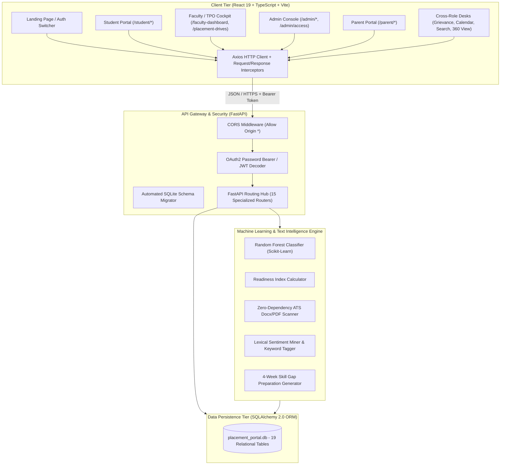
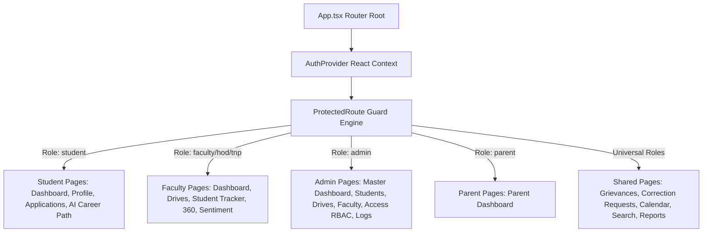
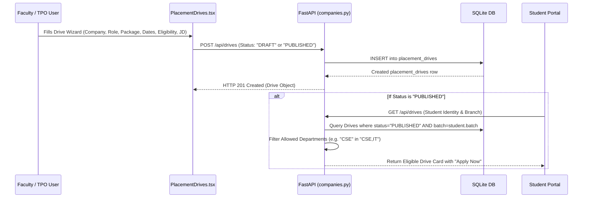
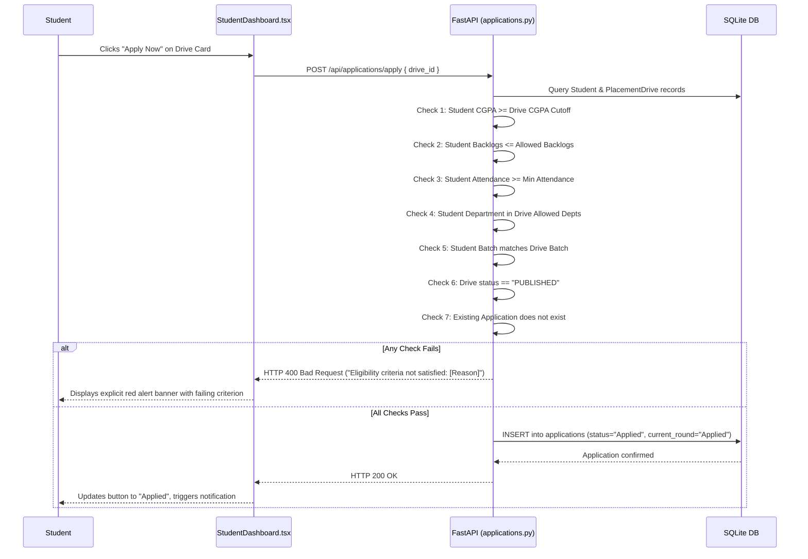

# Institutional Technical Architecture & System Specification Report
## Project: AI-Powered Placement Intelligence & Student Career Analytics Platform (AP-CPIP)
**Target Audience**: AI Systems (Claude), Technical Auditors, Solutions Architects, and Software Engineering Leads  
**Version**: 2.4.0-Production  
**Codebase Base Path**: `d:\placement portal`

---

## 1. Executive Summary & Problem Domain

### 1.1 Project Mission
The **AI-Powered Placement Intelligence & Student Career Analytics Platform (AP-CPIP)** is a full-stack, enterprise-grade institutional web platform designed for higher education institutions. It centralizes campus recruitment management, candidate readiness evaluation, corporate drive scheduling, interview tracking, and predictive career intelligence into a single, high-performance system.

### 1.2 Core Problem Solved
Traditional institutional placement cells rely on fragmented Excel spreadsheets, manual email broadcasts, disconnected Google Forms, and retrospective placement statistics. Consequently:
- **No Early Warning System**: Institutions cannot detect at-risk students before recruitment drives commence.
- **Manual Eligibility Checking**: TPOs manually cross-verify branch, batch, CGPA, attendance, and backlog criteria for thousands of students.
- **Lack of ATS Visibility**: Students do not know how their resumes score against specific corporate Job Descriptions (JDs).
- **Unstructured Senior Reviews**: Senior interview experiences remain anecdotal and unindexed.
- **Parent Disconnect**: Parents lack visibility into student placement eligibility and academic progress.

### 1.3 Key Innovations in AP-CPIP
1. **Dynamic Placement Predictor**: Integrates a dynamic Scikit-Learn **Random Forest Classifier** that evaluates campus selection probability based on academic and technical parameters.
2. **Composite Readiness Index (0–100)**: A deterministic multi-pillar scoring algorithm evaluating Academics (30%), Skills & Certifications (30%), Projects (25%), and Coding Profiles (15%).
3. **Zero-Dependency ATS Resume Scanner**: Parses `.docx` (via in-memory Zip-XML extraction) and `.pdf`/`.txt` (via byte-level printable ASCII regex streaming) to score resumes against corporate JDs without external OCR dependencies.
4. **Lexical NLP Interview Sentiment Miner**: Performs rule-based NLP lexical matching and topic extraction on interview reviews to measure polarity (-1.0 to +1.0) and extract commonly asked technical questions.
5. **Dynamic 4-Week Study Roadmap Generator**: Generates customized weekly preparation curriculums based on student skill gaps for specific company drives.
6. **High-Security Parent Portal**: SMS/OTP-verified access with sliding-window rate limiting, SHA-256 hash verification, cooldowns, and brute-force lockouts.
7. **Granular RBAC Console**: Institutional vs. Departmental scope, module-level actions (`VIEW`, `CREATE`, `EDIT`, `DELETE`, `EXPORT`), and time-bound expiries.
8. **Universal Accessibility**: Built to satisfy WCAG 2.1 Level AA with live screen-reader regions, ARIA dialogs, keyboard navigation, and dual-language (English/Telugu) support.

---

## 2. High-Level Architecture & Data Flow

AP-CPIP is structured as a modern decoupled client-server architecture with an asynchronous REST API backend and a reactive single-page application (SPA) frontend.



---

## 3. Technology Stack Matrix

### 3.1 Frontend Stack
- **Framework**: React `19.0.0`
- **Language**: TypeScript `5.2.2`
- **Build System**: Vite `5.1.4` (ESM native, HMR)
- **Routing**: React Router DOM `6.22.3` (Nested routes, declarative `ProtectedRoute` guards)
- **Styling**: Tailwind CSS `3.4.1` + Vanilla CSS HSL Design System (`index.css`)
- **Data Visualization**: Recharts `2.12.2` (Responsive SVG charts: Pie, Bar, Area, Radar)
- **Micro-interactions**: Framer Motion `11.0.8` + Canvas Confetti `1.9.2`
- **Iconography**: Lucide React `0.344.0` (ARIA-compliant SVGs)
- **Form Control**: React Hook Form `7.51.0`
- **HTTP Client**: Axios `1.6.7`

### 3.2 Backend Stack
- **Framework**: FastAPI `>=0.100.0` (Starlette core, asynchronous async/await endpoints)
- **Server**: Uvicorn `>=0.22.0` (ASGI event-loop server)
- **ORM**: SQLAlchemy `>=2.0.0` (Declarative models, relationship cascades, lazy/eager loading)
- **Data Validation**: Pydantic `>=2.0` & Pydantic Settings `>=2.0`
- **Cryptographic Security**:
  - `python-jose[cryptography]>=3.3.0` (HMAC-SHA256 JWT tokens)
  - Python standard library `hashlib.pbkdf2_hmac` & `secrets.token_hex(16)`: Implements PBKDF2-HMAC-SHA256 (50,000 iterations, random 16-byte salt) as the active password hashing implementation, adopted directly to avoid passlib/bcrypt compatibility and deprecation issues on Python 3.11+.
  - Python standard `hashlib` (SHA-256 OTP hashing)
- **Multipart Uploads**: `python-multipart>=0.0.6`
- **Data Science & ML**:
  - `scikit-learn>=1.2.0` (`RandomForestClassifier`, `StandardScaler`)
  - `pandas>=2.0.0`
  - `numpy>=1.24.0`
  - `xgboost>=1.7.0` (Benchmarking)

### 3.3 Database & Infrastructure
- **Active Database**: SQLite 3 (`placement_portal.db`, 17.3 MB active size, fully normalized)
- **Portability**: Database layer is 100% standard SQLAlchemy 2.0; can swap `DATABASE_URL` to PostgreSQL without modifying application logic.

---

## 4. Complete Codebase Directory & File Inventory

```
d:/placement portal/
├── backend/
│   ├── app/
│   │   ├── ml/
│   │   │   ├── __init__.py
│   │   │   ├── predictor.py           # Random Forest Classifier & Readiness Index Calculator
│   │   │   ├── resume_scanner.py      # In-memory DOCX XML & ASCII regex ATS engine
│   │   │   ├── nlp_feedback.py        # Lexical sentiment polarity & question extractor
│   │   │   └── feedback_miner.py      # Thematic keyword extraction & review aggregation
│   │   ├── routers/
│   │   │   ├── __init__.py
│   │   │   ├── auth.py                # Login, token issuance, coordinator management
│   │   │   ├── students.py            # Student CRUD, profile locks, bulk JSON uploader
│   │   │   ├── companies.py           # Company CRUD, placement drives, lifecycle management
│   │   │   ├── applications.py        # Drive applications, eligibility validation, offers
│   │   │   ├── analytics.py           # Institutional KPIs, CTC distributions, CSV exports
│   │   │   ├── ai.py                  # AI reports, ATS resume scanner, prep roadmaps
│   │   │   ├── parents.py             # Parent OTP dispatch, verification, student progress
│   │   │   ├── permissions.py         # Granular module RBAC matrix & access requests
│   │   │   ├── activities.py          # Workshops, mock interviews, pre-placement talks
│   │   │   ├── attendance.py          # Activity attendance recording & student percentages
│   │   │   ├── feedback.py            # Interview review submission & sentiment scoring
│   │   │   ├── grievances.py          # Student grievance ticketing & resolution remarks
│   │   │   ├── calendar.py            # Institutional placement events calendar
│   │   │   ├── search.py              # Scoped multi-table global search engine
│   │   │   └── notifications.py       # User notification polling & read-status toggling
│   │   ├── auth.py                    # JWT decoding, get_current_user dependencies
│   │   ├── config.py                  # Environment settings, secret keys, OTP parameters
│   │   ├── database.py                # SQLAlchemy engine, declarative Base, SessionLocal
│   │   ├── main.py                    # FastAPI app declaration, CORS, automated DB migrator
│   │   ├── models.py                  # 19 SQLAlchemy relational schema models
│   │   ├── schemas.py                 # Pydantic v2 validation models
│   │   └── seed.py                    # Seeding script (3,000 students, 155 companies, drives)
│   ├── requirements.txt               # Backend Python dependencies
│   └── run.py                         # Startup runner script (binds 127.0.0.1:8000)
├── frontend/
│   ├── src/
│   │   ├── assets/                    # Vector graphics and icons
│   │   ├── components/
│   │   │   ├── AccessibilityComponents.tsx # WCAG live toasts, modal escape listeners, ARIA dialogs
│   │   │   ├── DashboardLayout.tsx         # Responsive sidebar, role-filtered navigation links
│   │   │   ├── LoadingSkeleton.tsx         # Animated skeleton loading placeholders
│   │   │   └── ProfessionalTable.tsx       # Searchable, paginated table with CSV exporter
│   │   ├── hooks/
│   │   │   └── useAuth.tsx                 # React Context AuthProvider & JWT session store
│   │   ├── pages/
│   │   │   ├── LandingPage.tsx             # Public gateway, stats, role switcher, i18n
│   │   │   ├── Login.tsx                   # Unified login modal with demo credentials
│   │   │   ├── StudentDashboard.tsx        # Student KPIs, eligibility banner, active drives
│   │   │   ├── StudentProfile.tsx          # 8-sem SGPA chart, verified locks, ATS resume scan
│   │   │   ├── StudentApplications.tsx     # Application tracker, interview rounds, offer acceptance
│   │   │   ├── StudentAiReport.tsx         # AI readiness cockpit, skill gaps, 4-week roadmap
│   │   │   ├── FacultyDashboard.tsx        # Department stats, at-risk alerts, CTC curves
│   │   │   ├── PlacementDrives.tsx         # Drive creation wizard, JD editor, lifecycle manager
│   │   │   ├── StudentTracker.tsx          # Student filter grid, bulk JSON importer, CSV export
│   │   │   ├── Student360.tsx              # 360-degree student transcript, attendance, coding scores
│   │   │   ├── AISentimentMiner.tsx        # Polarity gauge, keyword cloud, difficulty ratings
│   │   │   ├── CorrectionRequests.tsx      # Side-by-side profile edit audit and approval
│   │   │   ├── Grievances.tsx              # Student grievance desk and resolution dialog
│   │   │   ├── Calendar.tsx                # Monthly/daily placement calendar with event chips
│   │   │   ├── Search.tsx                  # Global search with role-scoped result grouping
│   │   │   ├── ReportExporter.tsx          # Print-ready official PDF generator & Excel exports
│   │   │   ├── AccessManagement.tsx        # Admin RBAC permissions matrix & request review
│   │   │   ├── AdminDashboard.tsx          # Institutional macro stats & system health
│   │   │   ├── AdminStudents.tsx           # Master student database CRUD & inline editor
│   │   │   ├── AdminDrives.tsx             # Master drives oversight & status editor
│   │   │   ├── AdminFaculty.tsx            # Faculty coordinator assignments & department mapping
│   │   │   ├── AdminLogs.tsx               # Security audit trail & SQLite DB backup downloader
│   │   │   ├── ParentLogin.tsx             # Roll + Mobile OTP login with countdown timer
│   │   │   ├── ParentDashboard.tsx         # Parent student view: CGPA, attendance, drive progress
│   │   │   └── NotFound.tsx                # 404 error handler
│   │   ├── services/
│   │   │   └── api.ts                      # Centralized Axios client & typed service methods
│   │   ├── App.tsx                         # Master routing tree with ProtectedRoute guards
│   │   ├── index.css                       # Vanilla HSL token system, dark mode definitions
│   │   └── main.tsx                        # DOM mount root
│   ├── package.json                        # Frontend dependencies & scripts
│   ├── tailwind.config.js                  # Tailwind configuration & custom color palette
│   ├── tsconfig.json                       # TypeScript compiler options
│   └── vite.config.ts                      # Vite build configuration
└── placement_portal.db                     # Live SQLite database
```

---

## 5. Database Architecture & Schema Specifications

The database contains **19 relational tables**. Below is the exhaustive specification of all tables, fields, types, and constraints:

### 5.1 Tables & Live Row Counts

| Table Name | Primary Purpose | Live Row Count |
| :--- | :--- | :--- |
| `departments` | Academic engineering departments | 6 |
| `users` | User accounts and authentication credentials | 3,007 |
| `students` | Student academic and technical profiles | 3,000 |
| `faculty` | Faculty coordinators and designations | 6 |
| `companies` | Corporate recruiter directory | 155 |
| `placement_drives` | Recruitment drives, JDs, criteria, lifecycle states | 31 |
| `applications` | Student placement applications & offer statuses | 1,232 |
| `interviews` | Scheduled interview rounds per application | 305 |
| `feedbacks` | Candidate interview reviews & NLP sentiment logs | 304 |
| `notifications` | In-app user notifications | 33,159 |
| `system_logs` | Audit trail of security and administrative operations | 84 |
| `parents` | Parent registrations linked to students | 2 |
| `parent_otps` | Mobile OTP hash store with sliding-window rate limit | 2 |
| `permissions` | Granular module & department RBAC rules | 1 |
| `access_requests` | Elevated access request queue | 0 |
| `correction_requests`| Student profile edit requests for locked fields | 9 |
| `placement_activities`| Workshops, mock interviews, pre-placement talks | 0 |
| `activity_attendance`| Student attendance records for placement activities | 0 |
| `grievances` | Student grievance tickets & resolution remarks | 0 |

### 5.2 Table Column Specifications

#### 1. `departments`
- `id` (INTEGER, PK, AI)
- `name` (VARCHAR, UNIQUE, NOT NULL): Full name (e.g., `"Computer Science and Engineering"`)
- `code` (VARCHAR, UNIQUE, NOT NULL): Department code (e.g., `"CSE"`, `"IT"`, `"ECE"`, `"EEE"`, `"MECH"`, `"CIVIL"`)

#### 2. `users`
- `id` (INTEGER, PK, AI)
- `email` (VARCHAR, UNIQUE, INDEX, NOT NULL)
- `password_hash` (VARCHAR, NOT NULL): PBKDF2-HMAC-SHA256 salted hash (<salt_hex>$<key_hex>)
- `name` (VARCHAR, NOT NULL)
- `role` (VARCHAR, NOT NULL): `"student"`, `"faculty"`, `"admin"`, `"hod"`, `"tnp"`, `"parent"`
- `created_at` (DATETIME, DEFAULT `utcnow`)

#### 3. `students`
- `id` (INTEGER, PK, FK `users.id` ON DELETE CASCADE)
- `dept_id` (INTEGER, FK `departments.id`, NOT NULL)
- `gender` (VARCHAR, NOT NULL): `"Male"`, `"Female"`, `"Other"`
- `batch` (VARCHAR, NOT NULL): e.g., `"2026"`
- `section` (VARCHAR, DEFAULT `"A"`)
- `phone` (VARCHAR, NULLABLE)
- **Academics**:
  - `cgpa` (FLOAT, NOT NULL, DEFAULT `0.0`)
  - `attendance` (FLOAT, NOT NULL, DEFAULT `0.0`)
  - `backlogs` (INTEGER, NOT NULL, DEFAULT `0`)
  - `sgpa_sem1` to `sgpa_sem8` (FLOAT, NULLABLE): Semester-wise progression
- **Technical & Profiles**:
  - `skills` (TEXT): JSON array of skill strings
  - `projects` (TEXT): JSON array of project objects (`title`, `description`, `skills_used`)
  - `internships` (TEXT): JSON array of internship objects
  - `certifications` (TEXT): JSON array of certification objects
  - `github_url`, `linkedin_url`, `portfolio_url` (VARCHAR, NULLABLE)
  - `leetcode_score`, `codechef_score`, `hackerrank_score` (INTEGER, DEFAULT `0`)
- **AI & ATS Parameters**:
  - `readiness_score` (FLOAT, DEFAULT `0.0`): 0.0 to 100.0
  - `placement_probability` (FLOAT, DEFAULT `0.0`): 0.0 to 1.0
  - `ai_recommendations` (TEXT, NULLABLE): JSON string
  - `status` (VARCHAR, DEFAULT `"Unplaced"`): `"Placed"`, `"Unplaced"`, `"At Risk"`
  - `profile_completed` (BOOLEAN, DEFAULT `FALSE`)
  - `verification_status` (VARCHAR, DEFAULT `"UNVERIFIED"`): `"UNVERIFIED"`, `"VERIFIED"`, `"PENDING_CORRECTION"`
  - `resume_path` (VARCHAR, NULLABLE)
  - `resume_text` (TEXT, NULLABLE)
  - `resume_ats_score` (INTEGER, DEFAULT `0`)
  - `resume_analysis_json` (TEXT, NULLABLE)
  - `career_preferences` (TEXT, NULLABLE)

#### 4. `faculty`
- `id` (INTEGER, PK, FK `users.id` ON DELETE CASCADE)
- `dept_id` (INTEGER, FK `departments.id`, NOT NULL)
- `designation` (VARCHAR, NOT NULL): e.g., `"Associate Professor & TPO Coordinator"`

#### 5. `companies`
- `id` (INTEGER, PK, AI)
- `name` (VARCHAR, UNIQUE, INDEX, NOT NULL)
- `industry` (VARCHAR, NOT NULL): e.g., `"Information Technology"`, `"FinTech"`
- `website` (VARCHAR, NULLABLE)
- `description` (TEXT, NULLABLE)

#### 6. `placement_drives`
- `id` (INTEGER, PK, AI)
- `company_id` (INTEGER, FK `companies.id` ON DELETE CASCADE, NOT NULL)
- `role` (VARCHAR, NOT NULL): e.g., `"Full Stack Software Engineer"`
- `package_lpa` (FLOAT, NOT NULL): CTC in Lakhs Per Annum
- `location` (VARCHAR, NOT NULL): e.g., `"Hyderabad / Bangalore"`
- **Eligibility Criteria**:
  - `cgpa_cutoff` (FLOAT, NOT NULL, DEFAULT `6.0`)
  - `allowed_depts` (VARCHAR, NOT NULL): Comma-separated (e.g., `"CSE,IT,ECE"`)
  - `allowed_backlogs` (INTEGER, NOT NULL, DEFAULT `0`)
  - `min_attendance` (FLOAT, DEFAULT `75.0`)
  - `batch` (VARCHAR, DEFAULT `"2026"`)
- **Dates & Lifecycle**:
  - `interview_date` (DATE, NOT NULL)
  - `deadline` (DATE, NOT NULL)
  - `status` (VARCHAR, DEFAULT `"DRAFT"`): `"DRAFT"`, `"PUBLISHED"`, `"REGISTRATION_CLOSED"`, `"ONGOING"`, `"COMPLETED"`, `"CANCELLED"`
  - `created_at` (DATETIME, DEFAULT `utcnow`)
- **Job Description & Metadata**:
  - `job_id` (VARCHAR, UNIQUE, INDEX, NULLABLE): e.g., `"DRV-2026-GOOG"`
  - `responsibilities` (TEXT, NULLABLE)
  - `required_skills` (TEXT, NULLABLE): e.g., `"Python, React, SQL, DSA"`
  - `preferred_skills` (TEXT, NULLABLE)
  - `job_type` (VARCHAR, DEFAULT `"Full-Time"`): `"Full-Time"`, `"Internship"`, `"Contract"`
  - `work_mode` (VARCHAR, DEFAULT `"Onsite"`): `"Onsite"`, `"Hybrid"`, `"Remote"`
  - `openings_count` (INTEGER, DEFAULT `5`)
  - `hiring_process` (TEXT, NULLABLE)
  - `bond_details` (VARCHAR, NULLABLE)
  - `selection_process` (TEXT, NULLABLE)
  - `jd_pdf_path` (VARCHAR, NULLABLE)
  - `company_logo` (VARCHAR, NULLABLE)

#### 7. `applications`
- `id` (INTEGER, PK, AI)
- `student_id` (INTEGER, FK `students.id` ON DELETE CASCADE, NOT NULL)
- `drive_id` (INTEGER, FK `placement_drives.id` ON DELETE CASCADE, NOT NULL)
- `status` (VARCHAR, DEFAULT `"Applied"`): `"Applied"`, `"Eligible"`, `"Shortlisted"`, `"Selected"`, `"Rejected"`
- `current_round` (VARCHAR, DEFAULT `"Applied"`): `"Round 1"`, `"Round 2"`, `"Technical"`, `"Coding"`, `"HR"`, `"Selected"`
- `joining_status` (VARCHAR, DEFAULT `"Pending"`): `"Pending"`, `"Accepted"`, `"Declined"`
- `remarks` (TEXT, NULLABLE)
- `applied_date` (DATETIME, DEFAULT `utcnow`)

#### 8. `interviews`
- `id` (INTEGER, PK, AI)
- `application_id` (INTEGER, FK `applications.id` ON DELETE CASCADE, NOT NULL)
- `student_id` (INTEGER, FK `students.id` ON DELETE CASCADE, NOT NULL)
- `round_name` (VARCHAR, NOT NULL): `"Aptitude"`, `"Coding"`, `"Technical"`, `"HR"`
- `status` (VARCHAR, DEFAULT `"Scheduled"`): `"Scheduled"`, `"Passed"`, `"Failed"`
- `interview_date` (DATETIME, DEFAULT `utcnow`)
- `remarks` (TEXT, NULLABLE)

#### 9. `feedbacks`
- `id` (INTEGER, PK, AI)
- `interview_id` (INTEGER, FK `interviews.id` ON DELETE CASCADE, NULLABLE)
- `activity_id` (INTEGER, FK `placement_activities.id` ON DELETE CASCADE, NULLABLE)
- `experience_text` (TEXT, NOT NULL)
- `questions_asked` (TEXT, NULLABLE)
- `difficulty_rating` (INTEGER, DEFAULT `3`): 1 (Easy) to 5 (Extremely Hard)
- `preparation_time` (VARCHAR, NULLABLE)
- `suggestions` (TEXT, NULLABLE)
- `rating` (INTEGER, DEFAULT `3`)
- `theme` (VARCHAR, NULLABLE): e.g., `"DSA"`, `"System Design"`, `"Core Fundamentals"`
- `sentiment_score` (FLOAT, DEFAULT `0.0`): -1.0 to +1.0
- `extracted_keywords` (VARCHAR, NULLABLE): Comma-separated
- `topic_analysis` (VARCHAR, NULLABLE)

#### 10. `parents` & `parent_otps`
- `parents`:
  - `id` (PK), `student_id` (FK `students.id`, UNIQUE), `parent_name`, `mobile_number`, `relationship`
- `parent_otps`:
  - `id` (PK), `mobile_number`, `otp_hash`, `expires_at`, `attempts`, `created_at`, `last_requested_at`, `used_at`, `request_count`, `window_start`

#### 11. `permissions` & `access_requests`
- `permissions`:
  - `id` (PK), `user_id` (FK `users.id`), `module`, `scope` (`"DEPARTMENT"` / `"INSTITUTIONAL"`), `scope_value`, `action` (`"VIEW,CREATE,EDIT,DELETE,EXPORT"`), `start_date`, `expiry_date`, `status` (`"Active"` / `"Revoked"`)
- `access_requests`:
  - `id` (PK), `user_id` (FK `users.id`), `module`, `scope`, `scope_value`, `action`, `duration_days`, `reason`, `status` (`"Pending"`, `"Approved"`, `"Rejected"`)

#### 12. `correction_requests`
- `id` (PK), `student_id` (FK `students.id`), `field`, `current_value`, `requested_value`, `reason`, `status` (`"Pending"`, `"Approved"`, `"Rejected"`), `created_at`

#### 13. `placement_activities` & `activity_attendance`
- `placement_activities`:
  - `id` (PK), `placement_drive_id` (FK), `company_id` (FK), `activity_name`, `activity_type`, `date`, `start_time`, `end_time`, `location`, `description`, `mandatory` (BOOLEAN)
- `activity_attendance`:
  - `id` (PK), `activity_id` (FK), `student_id` (FK), `status` (`"Present"`, `"Absent"`, `"Excused"`), `remarks`

#### 14. `grievances`, `notifications`, `system_logs`
- `grievances`: `id` (PK), `student_id` (FK), `category`, `title`, `description`, `status` (`"OPEN"`, `"RESOLVED"`), `created_at`, `resolution_remarks`
- `notifications`: `id` (PK), `user_id` (FK), `title`, `message`, `is_read`, `created_at`
- `system_logs`: `id` (PK), `user_email`, `action`, `details`, `created_at`

---

## 6. Machine Learning, NLP & Predictive Algorithms

The intelligence layer is located in [backend/app/ml/](file:///d:/placement%20portal/backend/app/ml/).

### 6.1 Placement Predictor ([predictor.py](file:///d:/placement%20portal/backend/app/ml/predictor.py))
- **Model**: `RandomForestClassifier(n_estimators=100, random_state=42)`
- **Preprocessing**: `StandardScaler()`
- **Feature Extraction**:
  Each student record is converted to a numerical vector:
  - $x_1$: `cgpa` (float)
  - $x_2$: `attendance` (float)
  - $x_3$: `backlogs` (int)
  - $x_4$: `num_skills` (parsed from JSON)
  - $x_5$: `num_projects` (parsed from JSON)
  - $x_6$: `num_certs` (parsed from JSON)
  - $x_7$: `total_coding` = `leetcode_score` + `codechef_score` + `hackerrank_score`
- **Dynamic Training Pipeline**:
  ```python
  def train_model(self, db: Session):
      students = db.query(Student).all()
      # extracts feature vectors and labels (1 if status == "Placed" else 0)
      X = np.array([list(self._extract_features(s).values()) for s in students])
      y = np.array([1 if s.status == "Placed" else 0 for s in students])
      self.scaler.fit(X)
      self.model.fit(self.scaler.transform(X), y)
      self.is_trained = True
  ```
- **Inference**: Returns probability $P(\text{Placed} \mid \vec{X}) \in [0.0, 1.0]$. Students with $P < 0.40$ or active backlogs are categorized as `"At Risk"`.

### 6.2 Deterministic Readiness Index Algorithm
Calculates a score from $0$ to $100$ divided into 4 weighted pillars:
1. **Academics (30 pts max)**:
   $$\text{Academic Score} = \min\left(\frac{\text{CGPA}}{10} \times 20, 20\right) + \min\left(\frac{\text{Attendance}}{100} \times 10, 10\right) - (\text{Backlogs} \times 3.0)$$
   Bound to $[0, 30]$.
2. **Skills & Certifications (30 pts max)**:
   Up to 20 points for skill count (2.5 pts per skill) + up to 10 points for certifications (3.5 pts per verified cert).
3. **Projects (25 pts max)**:
   Up to 20 points for projects (7 pts per project) + 5 bonus points for portfolio / GitHub link presence.
4. **Coding Scores (15 pts max)**:
   Normalized sum of LeetCode, CodeChef, and HackerRank points:
   $$\text{Coding Score} = \min\left(\frac{\text{Total Coding}}{1500} \times 15, 15\right)$$

### 6.3 Zero-Dependency ATS Resume Scanner ([resume_scanner.py](file:///d:/placement%20portal/backend/app/ml/resume_scanner.py))
Extracts text without external binary dependencies:
- **DOCX Text Extraction**: Word `.docx` documents are zipped XML containers. The scanner reads `word/document.xml`, strips XML elements via regular expressions (`<[^>]*>`), and unescapes text.
- **PDF & Plaintext Extraction**: Fallback regex byte scanner isolating ASCII sequences (`rb"[\x20-\x7E\x0A\x0D]{4,}"`).
- **ATS Scoring Rules**:
  - Section Completeness (20 pts): Regex detection for `Education`, `Experience`, `Projects`, `Skills`.
  - JD Skill Matching (30 pts): Identifies required skills from the drive's JD string within the resume text tokens.
  - Keyword Gaps: Identifies missing keywords and suggests exact phrases to add.

### 6.4 Lexical NLP Sentiment Miner ([nlp_feedback.py](file:///d:/placement%20portal/backend/app/ml/nlp_feedback.py))
- Maintains curated lexicons of positive sentiment tokens (`"smooth"`, `"encouraging"`, `"supportive"`, `"helpful"`, `"fair"`, `"clear"`, `"well-structured"`) and negative tokens (`"harsh"`, `"rude"`, `"difficult"`, `"confusing"`, `"delayed"`, `"irrelevant"`, `"strict"`).
- Computes polarity:
  $$\text{Sentiment} = \frac{N_{\text{pos}} - N_{\text{neg}}}{N_{\text{pos}} + N_{\text{neg}} + 1} \in [-1.0, +1.0]$$
- Extracts questions via pattern matching (`"what is"`, `"how to"`, `"explain"`, `"difference between"`, `"?"`).
- Classifies thematic topics (`DSA`, `System Design`, `DBMS`, `Operating Systems`, `Web`, `HR`).

### 6.5 Dynamic 4-Week Company Preparation Roadmap
- Compares student's parsed skills against target drive's required skills.
- Produces a customized 4-week preparation timeline:
  - **Week 1: Quantitative Aptitude & Core CS Foundations** (Discrete Math, OOP, OS, Networks).
  - **Week 2: Advanced Data Structures & Algorithms** (Trees, Graphs, DP, company-specific test questions).
  - **Week 3: Tech Stack Deep Dive** (Addresses specific missing skills, e.g., Docker, Spring Boot, React).
  - **Week 4: Mock Interviews & Behavioral HR Prep** (STAR method, company culture, system design).

---

## 7. REST API Endpoint Catalog

All routes are mounted under `/api` in [main.py](file:///d:/placement%20portal/backend/app/main.py).

### 7.1 Authentication (`/api/auth`)
- `POST /api/auth/token`: Authenticates user credentials (email, password), returns `{ access_token, token_type, role, name, email }`.
- `GET /api/auth/me`: Returns current logged-in user profile.
- `POST /api/auth/coordinators`: (Admin only) Registers department faculty coordinator.
- `GET /api/auth/coordinators`: (Admin only) Lists all coordinators.
- `DELETE /api/auth/coordinators/{id}`: (Admin only) Deletes coordinator account.

### 7.2 Students (`/api/student`)
- `GET /api/student/list`: Filters students with pagination by `dept_id`, `batch`, `status`, `min_cgpa`, `max_backlogs`, `search`.
- `GET /api/student/{id}`: Returns full student profile with user and department objects.
- `PUT /api/student/{id}`: Updates academic, skill, and portfolio fields.
- `POST /api/student/bulk-import`: Accepts JSON list of candidate objects for bulk ingestion.
- `POST /api/student/lock-profile`: Toggles verification status between `UNVERIFIED` and `VERIFIED`.
- `DELETE /api/student/{id}`: Cascading deletion of student record and linked user account.

### 7.3 Companies & Placement Drives (`/api/companies` & `/api/drives`)
- `GET /api/companies/`: Lists registered recruiting companies.
- `POST /api/companies/`: Registers a new corporate recruiter.
- `GET /api/drives`: Lists placement drives with filters for status, department eligibility, and batch.
- `POST /api/drives`: Schedules placement drive with full JD metadata and eligibility criteria.
- `GET /api/drives/{id}`: Fetches drive details and required skills.
- `PUT /api/drives/{id}/status`: Updates drive lifecycle state (`DRAFT`, `PUBLISHED`, `REGISTRATION_CLOSED`, etc.).
- `GET /api/drives/{id}/applicants`: Lists all student applicants with their current round.

### 7.4 Applications & Offers (`/api/applications`)
- `POST /api/applications/apply`: Submits application to a drive with server-side eligibility checks:
  - CGPA $\ge$ Cutoff
  - Backlogs $\le$ Allowed Backlogs
  - Attendance $\ge$ Min Attendance
  - Department in Allowed Departments list
  - Batch matches drive batch
  - Drive status must be `PUBLISHED`
- `GET /api/applications/student/{id}`: Lists all applications submitted by student.
- `PUT /api/applications/{id}/status`: Updates application status (`Shortlisted`, `Selected`, etc.) and current round.
- `POST /api/applications/{id}/accept-offer`: Accepts job offer; updates student status to `"Placed"`.

### 7.5 AI & Intelligence Services (`/api/ai`)
- `GET /api/ai/student-report/{student_id}`: Returns readiness score, placement probability, skill gaps, and recommended certs.
- `GET /api/ai/prep-roadmap/{drive_id}`: Returns tailored 4-week preparation plan.
- `POST /api/ai/resume-scanner`: Accepts multipart file upload (`.docx`, `.pdf`, `.txt`) and `drive_id`, returns ATS score, matched skills, and missing keywords.
- `GET /api/ai/sentiment-miner`: Aggregates sentiment analytics and extracted interview keywords.

### 7.6 Parent Portal (`/api/parents`)
- `POST /api/parents/send-otp`: Dispatches rate-limited 6-digit OTP to registered mobile number.
- `POST /api/parents/verify-otp`: Validates OTP against stored hash, returns parent-scoped JWT token.
- `GET /api/parents/dashboard-data`: Returns linked student's academics, attendance, drives, and applications.

### 7.7 Access Control & Permissions (`/api/permissions`)
- `GET /api/permissions/user/{user_id}`: Returns active permissions for a user.
- `POST /api/permissions/grant`: (Admin only) Grants scoped permission with expiry date.
- `POST /api/permissions/revoke/{id}`: Revokes permission grant.
- `POST /api/permissions/request-access`: Submits an elevated access request.
- `GET /api/permissions/requests`: (Admin only) Lists pending access requests.
- `PUT /api/permissions/requests/{id}`: Approves or rejects access request.

### 7.8 Placement Activities & Attendance (`/api/activities` & `/api/attendance`)
- `GET /api/activities`: Lists upcoming placement activities (workshops, tests, mock interviews).
- `POST /api/activities`: Schedules new activity.
- `POST /api/attendance/mark`: Records student attendance (`Present`, `Absent`, `Excused`).
- `GET /api/attendance/student/{student_id}`: Computes student's activity attendance percentage.

### 7.9 Feedback & Reviews (`/api/feedback`)
- `POST /api/feedback`: Submits interview or activity feedback with automated NLP sentiment tagging.
- `GET /api/feedback/all`: Lists feedback entries with sentiment polarity scores.

### 7.10 Grievances (`/api/grievances`)
- `POST /api/grievances`: Lodges grievance ticket.
- `GET /api/grievances`: Lists grievances (filtered by role and department).
- `PUT /api/grievances/{id}/resolve`: Resolves grievance ticket with official remarks.

### 7.11 Scoped Calendar & Global Search (`/api/calendar` & `/api/search`)
- `GET /api/calendar/events`: Returns placement calendar events (drives, deadlines, interviews, activities).
- `GET /api/search`: Performs scoped cross-table search across students, companies, drives, and activities.

### 7.12 Analytics & Exports (`/api/analytics`)
- `GET /api/analytics/dashboard-stats`: Returns institutional macro KPIs.
- `GET /api/analytics/department-stats`: Returns branch-by-branch placement percentages and average packages.
- `GET /api/analytics/salary-distribution`: Returns CTC distribution tiers.
- `GET /api/analytics/export/csv`: Streams CSV export of placement records.

---

## 8. Frontend SPA Architecture & Component Design

The frontend is organized in [frontend/src/](file:///d:/placement%20portal/frontend/src/):



### 8.1 State Management & Session Lifecycle
- **Context API (`useAuth.tsx`)**: Stores active user object, authentication token, and role.
- **Storage**: Persists JWT in browser `localStorage`.
- **Axios Interceptors (`api.ts`)**:
  - Request Interceptor: Automatically injects `Authorization: Bearer <token>` into all outgoing HTTP headers.
  - Response Interceptor: Catches HTTP 401 Unauthorized errors and redirects user to `/login`.

### 8.2 Page Inventory & Key UI Features

| Page Component | Route Path | Access Roles | Key Features & Capabilities |
| :--- | :--- | :--- | :--- |
| `LandingPage.tsx` | `/` | Public | Public portal, placement highlights, role switcher, dark mode toggle, English/Telugu language switcher. |
| `Login.tsx` | `/login` | Public | Unified login modal with quick autofill demo buttons for Student, Faculty, and Admin. |
| `ParentLogin.tsx` | `/parent/login` | Public | Roll number + mobile number input, 6-digit OTP verification, resend cooldown timer. |
| `ParentDashboard.tsx`| `/parent/dashboard`| `parent` | Student academic transparency, attendance warning badges, drive application statuses. |
| `StudentDashboard.tsx`| `/student` | `student` | Readiness Score gauge, CGPA, attendance, active drives with instant "Apply Now" eligibility check. |
| `StudentProfile.tsx` | `/student/profile` | `student` | 8-semester SGPA progression chart, locked verified indicator, ATS resume uploader and instant analyzer. |
| `StudentApplications.tsx`| `/student/applications`| `student` | Application pipeline tracking, interview round details, offer acceptance with confetti animation, feedback modal. |
| `StudentAiReport.tsx`| `/student/ai-career-path`| `student` | AI placement probability meter, skill gaps, recommended certs, dynamic 4-week company preparation roadmap. |
| `FacultyDashboard.tsx`| `/faculty-dashboard`| `faculty, admin, hod, tnp` | Department KPIs, at-risk candidate radar, CTC package curves, recruitment funnel. |
| `PlacementDrives.tsx`| `/placement-drives`| `faculty, admin, hod, tnp` | Drive creation wizard, multi-branch eligibility builder, JD editor, drive lifecycle manager (`DRAFT` $\rightarrow$ `PUBLISHED`). |
| `StudentTracker.tsx` | `/student-tracker` | `faculty, admin, hod, tnp` | Multi-filter candidate directory, CSV downloader, bulk JSON candidate importer. |
| `Student360.tsx` | `/student-360/:id` | `faculty, admin, hod, tnp` | Single-pane view of student transcript, coding ratings, ATS scores, grievances, and application history. |
| `AISentimentMiner.tsx`| `/ai-sentiment-miner`| `faculty, admin, hod, tnp` | NLP sentiment polarity meter, interview question keyword tag cloud, difficulty rating distributions. |
| `CorrectionRequests.tsx`| `/correction-requests`| Universal | Profile edit request queue; side-by-side comparison of current vs requested values with approve/reject actions. |
| `Grievances.tsx` | `/grievances` | Universal | Student grievance lodging, status badges (`OPEN`, `RESOLVED`), official resolution dialog. |
| `Calendar.tsx` | `/calendar` | Universal | Unified placement calendar with color-coded event chips for drives, tests, interviews, and deadlines. |
| `Search.tsx` | `/search` | Universal | Instant global search across students, companies, drives, and activities with role-based scoping. |
| `ReportExporter.tsx` | `/report-exporter` | `faculty, admin, hod, tnp` | Print-ready official PDF report generation with institutional headers and bulk Excel/CSV dataset export. |
| `AccessManagement.tsx`| `/admin/access` | `admin` | Granular RBAC permission matrix editor (module, scope, action, dates) and elevated access request queue. |
| `AdminDashboard.tsx` | `/admin` | `admin` | Institution-wide macro analytics, department comparisons, operational health monitors. |
| `AdminStudents.tsx` | `/admin/students` | `admin` | Master student database CRUD, batch actions, verification status toggling, inline editor. |
| `AdminDrives.tsx` | `/admin/drives` | `admin` | Master placement drives table, status overrides, deadline extensions, package auditing. |
| `AdminFaculty.tsx` | `/admin/faculty` | `admin` | Faculty and department placement coordinator account creation and department assignment. |
| `AdminLogs.tsx` | `/admin/logs` | `admin` | Real-time audit log of system operations and one-click SQLite database backup downloader. |
| `NotFound.tsx` | `/404` | Public | Standard 404 handler with redirect back to home. |

---

## 9. Security, Authentication & Access Control (RBAC)

### 9.1 Authentication Pipeline
1. Client submits credentials via `POST /api/auth/token`.
2. Backend queries `users` table, verifies password hash using standard library `hashlib.pbkdf2_hmac('sha256', ..., 50000)` with per-hash random salt.
3. If valid, generates a JWT signed with `SECRET_KEY` using algorithm `HS256` containing `{ sub: user.email, role: user.role, id: user.id }` with a 24-hour expiration window.
4. Client stores JWT in `localStorage` and includes it in all requests via the `Authorization: Bearer <token>` header.

### 9.2 Parent Portal SMS/OTP Security Architecture
Configured in [config.py](file:///d:/placement%20portal/backend/app/config.py):
- **Rate Limit Window**: 1 hour (`OTP_RATE_LIMIT_WINDOW_HOURS = 1`).
- **Max Requests**: 5 OTP requests per mobile number per hour (`OTP_MAX_REQUESTS_PER_WINDOW = 5`).
- **Cooldown**: 60 seconds required between subsequent OTP requests (`OTP_RESEND_COOLDOWN_SECONDS = 60`).
- **Expiry**: OTP expires in 5 minutes (`OTP_EXPIRY_MINUTES = 5`).
- **Brute-Force Lockout**: Maximum 3 attempts allowed per OTP (`OTP_MAX_VERIFY_ATTEMPTS = 3`).
- **Cryptographic Storage**: OTPs are hashed using SHA-256 before saving to `parent_otps`.

### 9.3 Granular RBAC Matrix
Managed via the `permissions` table:
- **Modules**: `Student Performance`, `Placement Drives`, `Analytics`, `System Logs`.
- **Scopes**: `DEPARTMENT` (restricted to coordinator's assigned department) vs `INSTITUTIONAL` (campus-wide).
- **Actions**: `VIEW`, `CREATE`, `EDIT`, `DELETE`, `EXPORT`.
- **Time-Bound Validity**: Permissions contain explicit `start_date` and `expiry_date` timestamps, with automatic revocation on expiration.

---

## 10. Key Workflows & Lifecycle Sequences

### 10.1 Placement Drive Creation & Publishing Lifecycle



### 10.2 Student Application & Eligibility Verification Workflow



---

## 11. Engineering Bug Fixes & System Integrity Audits

### 1. Drive Scheduling Bug Fix
- **Symptom**: TPO and Faculty portals showed `"Failed to schedule placement drive"` when submitting the drive creation form.
- **Root Cause**: Schema mismatch between frontend form fields and backend Pydantic models. Backend expected specific date objects and fields (`min_attendance`, `batch`, `allowed_depts`) that were missing default values.
- **Fix**: Aligned Pydantic schemas in [schemas.py](file:///d:/placement%20portal/backend/app/schemas.py), added fallback defaults, updated form handlers in [PlacementDrives.tsx](file:///d:/placement%20portal/frontend/src/pages/PlacementDrives.tsx), and added automated database column migrations in [main.py](file:///d:/placement%20portal/backend/app/main.py).

### 2. Department Code Normalization Fix
- **Symptom**: Student portal showed `"No active placement drives found"` even when published drives existed.
- **Root Cause**: Case sensitivity and abbreviation mismatches (e.g., student branch `"Computer Science & Engineering"` vs drive allowed departments `"CSE"`).
- **Fix**: Implemented bidirectional department normalization in [companies.py](file:///d:/placement%20portal/backend/app/routers/companies.py) that maps between full department names and short codes before matching.

### 3. Automated Database Schema Migrations
- Implemented `migrate_database()` in [main.py](file:///d:/placement%20portal/backend/app/main.py) to automatically inspect SQLite PRAGMA table columns on startup and add missing columns (`activity_id`, `rating`, `theme`, `verification_status`, `section`, `portfolio_url`, `career_preferences`, `min_attendance`, `batch`, `parent_otps` rate-limiting columns) without data loss.

---

## 12. Local Setup, Execution & Testing Guide

### 12.1 Prerequisites
- Python 3.10+
- Node.js 18+ and npm

### 12.2 Backend Execution
```powershell
cd "d:\placement portal"
# Ensure dependencies are installed
pip install -r backend/requirements.txt

# Launch FastAPI backend with auto-reload
python backend/run.py
```
- **Backend URL**: `http://127.0.0.1:8000`
- **Swagger API Docs**: `http://127.0.0.1:8000/docs`
- **ReDoc Docs**: `http://127.0.0.1:8000/redoc`

### 12.3 Frontend Execution
```powershell
cd "d:\placement portal\frontend"
# Ensure dependencies are installed
npm install

# Launch Vite dev server
npm run dev
```
- **Frontend URL**: `http://localhost:5173`

### 12.4 Pre-configured Demonstration Accounts

| Stakeholder Role | Email / Identifier | Password | Access Scope |
| :--- | :--- | :--- | :--- |
| **System Administrator** | `admin@college.edu` | `admin123` | Institutional Master Dashboard, RBAC Console, Audit Logs |
| **Faculty Coordinator (CSE)** | `faculty.cse@college.edu` | `faculty123` | CSE Department Cockpit, Drive Scheduler, Student 360 |
| **Faculty Coordinator (ECE)** | `faculty.ece@college.edu` | `faculty123` | ECE Department Cockpit, Drive Scheduler, Student 360 |
| **Student** | `student1@college.edu` | `student123` | Student Dashboard, Applications, AI Career Path, ATS Scanner |
| **Parent** | Roll: `2026CSE0001`<br>Mobile: `9876543210` | OTP Verification | Parent Student Transparency Portal |

---

## 13. Summary

The **AI-Powered Placement Intelligence & Student Career Analytics Platform (AP-CPIP)** is an end-to-end, production-ready system with:
- **3,000 students, 155 companies, and 31 recruitment drives** in an active SQLite database.
- **15 FastAPI backend routers** handling authentication, student profiles, drives, applications, analytics, AI, parent OTP access, and RBAC.
- **25 responsive frontend pages** with dark mode, WCAG 2.1 AA accessibility, and dual-language support.
- **Integrated ML and NLP models** for placement readiness prediction, zero-dependency ATS resume scanning, interview sentiment mining, and dynamic preparation roadmap generation.

*Report compiled for AI review, institutional audits, and technical evaluation.*
