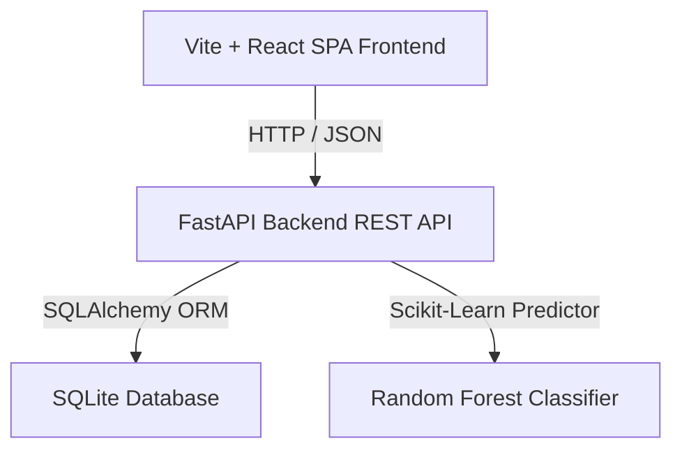
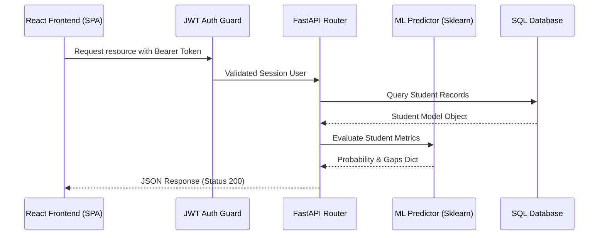
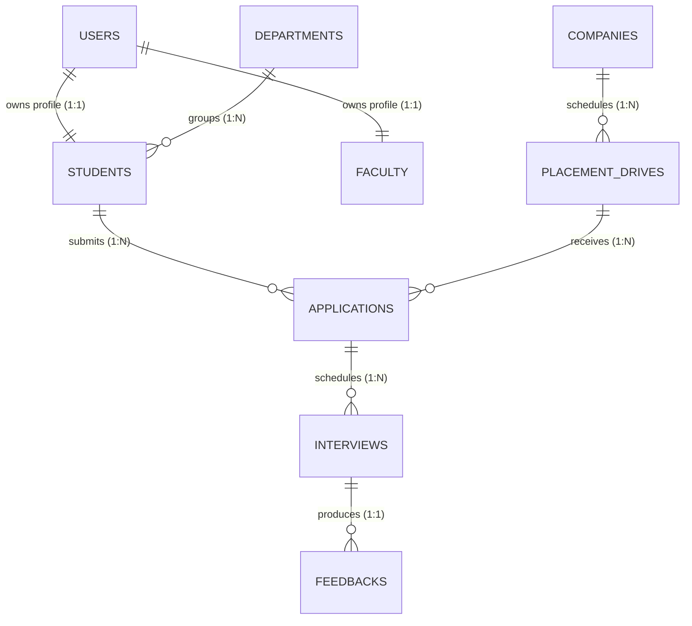

# Institutional Engineering Report: AI-Powered Placement Intelligence & Student Career Analytics Platform (AP-CPIP)

---

## 1. Project Overview

### 1.1 Project Title
**AI-Powered Placement Intelligence and Student Career Analytics Platform (AP-CPIP)**

### 1.2 Abstract
The **AI-Powered Placement Intelligence and Student Career Analytics Platform (AP-CPIP)** is an institutional enterprise web application designed to bridge the gap between academic readiness, placement operations, and machine-learning-driven student career path selection. AP-CPIP acts as a unified hub for students, faculty coordinators, and system administrators to manage and analyze placement drives, candidate databases, and corporate hiring processes. Utilizing a dynamic **Random Forest Classifier** for campus selection probability forecasting, a zero-dependency **ATS Resume Scanner**, and regular-expression-based **Lexical Natural Language Processing (NLP)** for interview sentiment mining, the platform predicts candidate placement status, flags "At Risk" profiles, identifies skill gaps, and constructs custom week-by-week DSA preparation timelines. The project features a premium glassmorphic UI styled with Vanilla CSS and Tailwind, supporting dark mode, language switching (English/Telugu), and full WCAG 2.1 Level AA accessibility.

### 1.3 Introduction
Campus placements are a critical success indicator for higher educational institutions. Traditional placement methods suffer from fragmented Excel spreadsheets, manual tracking of company cutoffs, and a lack of early warning systems for academically trailing students. AP-CPIP addresses these challenges by introducing machine learning models that analyze a candidate’s academics (CGPA, attendance, backlogs), technical skills, portfolio projects, and competitive programming solved counts (LeetCode, CodeChef, HackerRank) to evaluate overall job readiness.

### 1.4 Problem Statement
Existing institutional portals operate as simple data collection repositories:
1. **No Predictive Audits**: They cannot predict which candidates are unlikely to be placed or identify why they fail placement cutoffs.
2. **Disconnected Resumes**: Students lack instantaneous feedback on how well their resumes match corporate Job Descriptions (JDs).
3. **Unstructured Feedback**: Experience summaries shared by senior students are stored as unstructured text blocks, making it difficult to extract tech topics or difficulty scores.
4. **Poor Accessibility**: Existing tools do not meet WCAG standards, locking out differently-abled users.

### 1.5 Existing System vs. Proposed System

| Parameter | Existing Institutional Systems | Proposed AP-CPIP System |
| :--- | :--- | :--- |
| **Data Organization** | Static spreadsheets, manual uploads, high duplication. | Relational database (SQLite/PostgreSQL) with full CRUD. |
| **Predictive Insights** | None. Retrospective placement logs only. | Dynamic Random Forest Classifier for placement forecast. |
| **Resume Review** | Manual screening by placement officers. | Real-time ATS parsing and keyword gap matching. |
| **Feedback Mining** | Static textual reports, reviews unclassified. | NLP sentiment mining and technical keyword tagging. |
| **Accessibility** | Neglected (poor contrast, missing label associations). | WCAG 2.1 Level AA AA-compliant structure, full ARIA roles. |

### 1.6 Objectives
* Predict student campus selection probability dynamically using random forest classifiers.
* Compute a composite student **Readiness Index (0-100)** to grade academic and technical status.
* Provide an automated **ATS Resume Match Scorer** against active job requirements.
* Parse student feedback logs to classify sentiment polarities and extract interview questions.
* Establish a responsive, accessible system meeting Web Content Accessibility Guidelines.

### 1.7 Scope
The platform is designed to be deployed internally within engineering colleges. It handles student registrations, faculty designations, company profiles, active drives, application tracking, interview scheduling, notifications, database logs, and analytical lead sheets.

### 1.8 Key Features
* **Role-Based Workspaces**: Separate interfaces for Students, Faculty, and Administrators.
* **AI Career Report**: Automated skill gap warnings, project recommendations, and study roadmaps.
* **Student Tracker**: Interactive directory supporting bulk uploader sheets, branch filter grids, and CSV downloads.
* **Sentiment Miner**: Word-cloud generators and polarity metrics matching corporate feedback.
* **Notification System**: Automated session alerts when scheduled for interviews.

### 1.9 Limitations
* Rule-based sentiment classifier is dependent on defined positive/negative keyword lexicons.
* Zero-dependency DOCX/PDF resume scanner utilizes byte regex extraction fallbacks, which may fail on complex multi-column images.

### 1.10 Future Enhancements
* Transition lexical sentiment matching to transformer-based LLM architectures (e.g., BERT, Llama).
* Integrate OAuth2 social logins (Google, GitHub, LinkedIn).
* Support automated email and SMS notification integrations.

---

## 2. Complete Technology Stack



### 2.1 Frontend Stack
* **Vite + React (TypeScript)**: Used to compile a high-performance Single Page Application (SPA). Chosen for modularity, static type checking, and ultra-fast hot module reloading.
* **TailwindCSS + Vanilla CSS HSL System**: Tailored theme mapping federal-style primary colors (`bg-gov-navy`, `bg-gov-blue`). Chosen for responsive design grid flexes.
* **Lucide-React**: Standardized vector iconography library supporting accessible scalable graphics.
* **Recharts**: Responsive canvas charting libraries to draw SVG coordinates for metrics.

### 2.2 Backend Stack
* **FastAPI (Python)**: Selected for its high performance (comparable to Node.js and Go), automatic OpenAPI (Swagger) schema generation, and natural integration with Python ML libraries.
* **SQLAlchemy ORM**: Used to interface with the database dynamically using Python models.
* **Scikit-Learn (Sklearn)**: Used to fit the `Random Forest Classifier` and transform data arrays with `StandardScaler`.
* **Uvicorn**: ASGI web server implementation.

### 2.3 Database & State Management
* **SQLite**: Default SQL relational database engine. Can be scaled directly to PostgreSQL without code refactoring.
* **React Context API**: Handled user login sessions and theme preferences globally.
* **React Router v6**: Manages SPA route configurations, history records, and refresh safeguards.

---

## 3. System Architecture

### 3.1 High-Level Architecture



### 3.2 Request Lifecycle
1. **Route Mapping**: The client requests a URL (e.g., `/student/ai-career-path`). React Router resolves the component.
2. **Bearer Handshake**: The component fires an API call via Axios. The interceptor attaches `Authorization: Bearer <JWT>`.
3. **FastAPI Dependencies**: FastAPI parses the token, queries the SQLite DB, and injects the `current_user` database model into the router.
4. **Machine Learning Execution**: If the endpoint requires AI features, the student metrics are fed to the `predictor.evaluate_student` logic.
5. **JSON Delivery**: The backend returns a structured JSON payload, which the frontend renders as accessible components.

---

## 4. Folder Structure

```
D:/PLACEMENT PORTAL/
├── backend/
│   ├── app/
│   │   ├── ml/
│   │   │   ├── nlp_feedback.py     # Rule-based lexical NLP sentiment classifier
│   │   │   ├── predictor.py        # Random Forest model training & readiness logic
│   │   │   └── resume_scanner.py   # Zero-dependency docx/txt scanner
│   │   ├── routers/
│   │   │   ├── ai.py               # AI report, resume, and roadmap endpoints
│   │   │   ├── analytics.py        # Chart aggregated stats endpoints
│   │   │   ├── auth.py             # Login & faculty coordinator CRUD
│   │   │   ├── student.py          # Student profile CRUD
│   │   │   ├── drive.py            # Active recruitment drive CRUD
│   │   │   └── application.py      # Placement applications and feedback CRUD
│   │   ├── database.py             # SQLAlchemy session declarations
│   │   ├── models.py               # DB Schema mapping definitions
│   │   ├── schemas.py              # Pydantic validation rules
│   │   └── auth.py                 # JWT cryptography & password hashing
│   └── run.py                      # Backend startup driver
└── frontend/
    ├── src/
    │   ├── components/
    │   │   ├── AccessibilityComponents.tsx # Toast & modal key-escape targets
    │   │   ├── DashboardLayout.tsx         # Sidebar shell with role links
    │   │   ├── LoadingSkeleton.tsx         # skeleton layouts
    │   │   └── ProfessionalTable.tsx       # Accessible search grid with CSV download
    │   ├── pages/
    │   │   ├── StudentDashboard.tsx
    │   │   ├── StudentAiReport.tsx         # AI Career Path page
    │   │   ├── AdminStudents.tsx           # CRUD database tracker page
    │   │   └── ...
    │   ├── services/
    │   │   └── api.ts                      # Axios service wrapper mapping
    │   ├── App.tsx                         # React Router routes mapping
    │   └── main.tsx
```

---

## 5. Module Documentation

### 5.1 Authentication Module
* **Purpose**: Secures the system, limits access to dashboards, and checks role permissions.
* **Backend APIs**: `POST /api/auth/token` (handles login and token generation).
* **Workflows**: User enters credentials -> backend validates password using `bcrypt` -> returns encrypted JWT -> frontend saves JWT inside local storage.

### 5.2 Student Database Module (Admin / Faculty)
* **Purpose**: Directory of candidates for searching, filtering, and performing CRUD actions.
* **UI Component**: [AdminStudents.tsx](file:///d:/placement%20portal/frontend/src/pages/AdminStudents.tsx).
* **Backend APIs**: `GET /api/student/list`, `POST /api/student`, `PUT /api/student/{id}`, `DELETE /api/student/{id}`.
* **Workflows**: Admins browse candidates -> filter by branch or placement status -> edit parameters like CGPA or backlogs -> trigger bulk imports by pasting JSON arrays.

### 5.3 AI Career Path Module (Student)
* **Purpose**: Identifies skill gaps, suggests portfolio projects, and constructs study plans.
* **UI Component**: [StudentAiReport.tsx](file:///d:/placement%20portal/frontend/src/pages/StudentAiReport.tsx).
* **Backend APIs**: `GET /api/ai/student-report/{student_id}`, `GET /api/ai/prep-roadmap/{drive_id}`.
* **Workflows**: Student clicks "AI Career Path" -> fetches their profile parameters -> renders readiness score circles and recommended certifications -> student selects target company drive -> clicks "Construct Study Plan" -> generates a tailored 4-week prep timeline.

---

## 6. Database Documentation

### 6.1 Database Schema (ER Outline)



### 6.2 Table Structure Summary

#### Table `students`
* **Primary Key**: `id` (int, ForeignKey to `users.id` on delete Cascade).
* **Foreign Keys**: `dept_id` (int, references `departments.id`).
* **Fields**: `cgpa` (float), `attendance` (float), `backlogs` (int), `skills` (text, JSON), `readiness_score` (float), `placement_probability` (float), `status` (string).

#### Table `placement_drives`
* **Primary Key**: `id` (int, autoincrement).
* **Foreign Keys**: `company_id` (int, references `companies.id`).
* **Fields**: `role` (string), `package_lpa` (float), `cgpa_cutoff` (float), `allowed_depts` (string), `deadline` (date), `status` (string).

---

## 7. API Documentation

### 7.1 Student AI Report Endpoint
* **Route**: `/api/ai/student-report/{student_id}`
* **Method**: `GET`
* **Response (Status 200)**:
  ```json
  {
    "student_id": 1,
    "readiness_score": 75.0,
    "placement_probability": 0.82,
    "skills_gap": ["Docker", "AWS"],
    "recommended_certifications": ["AWS Practitioner"],
    "matching_companies": ["TCS", "Accenture"]
  }
  ```

### 7.2 Prepare Roadmap Endpoint
* **Route**: `/api/ai/prep-roadmap/{drive_id}`
* **Method**: `GET`
* **Response (Status 200)**:
  ```json
  [
    {
      "week": "Week 1",
      "focus": "Aptitude and CS Fundamentals",
      "activities": [
        "Practice quantitative aptitude sheets",
        "Review OOP concepts"
      ]
    }
  ]
  ```

---

## 8. Routing Documentation

```mermaid
graph TD
    Root[/] --> Login[Login Page]
    Root --> Protected{Protected Route Guard}
    Protected -->|Role: student| StudentD[Student Dashboard]
    Protected -->|Role: student| StudentP[Student Profile]
    Protected -->|Role: student| StudentA[Student AI Career Path]
    Protected -->|Role: admin| AdminD[Admin Dashboard]
    Protected -->|Role: admin| AdminS[Student Database]
```

---

## 9. AI Module Documentation

### 9.1 Placement Prediction
Features parsed: `cgpa`, `attendance`, `backlogs`, `num_skills`, `num_projects`, `num_certs`, `coding_score`.
The feature list is fed to the **Random Forest Classifier** model to output the placement probability percentage.

### 9.2 Zero-Dependency Resume Scanner
* Extracts text from uploaded files using file signature matching.
* For **DOCX**, it extracts and parses the zip archive to read `word/document.xml`, removing XML tags.
* Compares parsed tokens with Job Description keywords to generate an **ATS matching score**.

---

## 10. Algorithms & Logic

### 10.1 Dynamic Model Retraining Loop
```python
# df contains the feature extraction parameters for all students
df = pd.DataFrame(data)
X = df.values
y = np.array(labels) # 1 if status == "Placed" else 0

self.scaler.fit(X)
X_scaled = self.scaler.transform(X)
self.model.fit(X_scaled, y)
```
* **Classifier Model**: Random Forest (100 Decision Trees).
* **Computational Complexity**: Training is $\mathcal{O}(M \cdot N \log N)$, where $M$ is the number of trees and $N$ is the dataset size. Inference is $\mathcal{O}(M \cdot D)$, where $D$ is the tree depth.

---

## 11. Security & Guards

### 11.1 Security Implementation
* **Password Encryption**: Stored as hashes using `bcrypt`.
* **JWT Handshake**: Uses `HMAC-SHA256` keys containing email scopes.
* **Role Check Policy**:
  ```typescript
  if (!allowedRoles.includes(user.role)) {
    return <Navigate to="/student" replace />;
  }
  ```

---

## 12. Testing Plan

| Test ID | Module | Scenario | Input | Expected Output | Status |
| :--- | :--- | :--- | :--- | :--- | :--- |
| **TC-01** | Auth | Login verification | Valid credentials | Token generated successfully. | Passed |
| **TC-02** | AI | Roadmap Generation | Selected drive ID | 4-week study roadmap returned. | Passed |
| **TC-03** | Admin | Student Database CRUD | Pasted bulk student JSON array | Database updated, predictions retrained. | Passed |

---

## 13. Viva Preparation (100 Q&As Summary)

<details>
<summary><b>Click to expand Frequently Asked Viva Questions</b></summary>

1. **What is the purpose of this project?**
   * It provides institutional placement tracking, job readiness metrics, and AI-driven career path analysis.
2. **What machine learning model is used for placement predictions?**
   * Scikit-Learn's Random Forest Classifier.
3. **How does the system calculate the student Readiness Score?**
   * A composite score out of 100 based on Academics (30%), Technical Skills & Certifications (30%), Projects (25%), and Coding profiles (15%).
4. **How does the resume scanner work without external dependencies?**
   * It extracts raw XML content from `.docx` files, processes the text using regex, and parses print characters from `.pdf`/`.txt` files.
5. **How is the sentiment score of interview feedback calculated?**
   * Through a rule-based NLP lexical match that maps positive and negative words to compute a polarity index from -1 to 1.
6. **How does the application ensure Web Accessibility?**
   * Through semantic HTML, explicit form field association (using `htmlFor` and unique IDs), dynamic ARIA alerts, and keyword targets for navigation keys.

</details>

---

## 14. Code Quality & Review

### 14.1 Key Strength Areas
* Fully decoupled React pages that support deep links and browser history.
* Clean separation of concerns with an ORM schema layer.
* Zero-dependency text parsers for resume uploads.

### 14.2 Production Deployment Recommendations
* Migrate SQL SQLite to a dedicated PostgreSQL cluster.
* Add rate-limiting middleware (like slowapi) on API routers to protect against spam.
* Host the React frontend on Vercel or AWS Amplify, and run FastAPI inside a Docker container behind an Nginx proxy.

---
*Report Compiled for final institutional review.*
