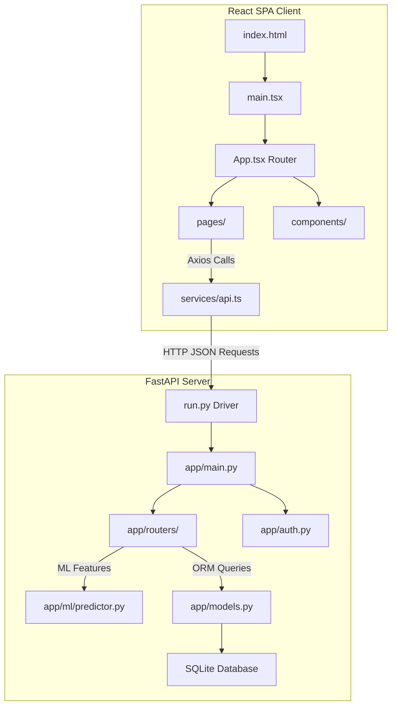
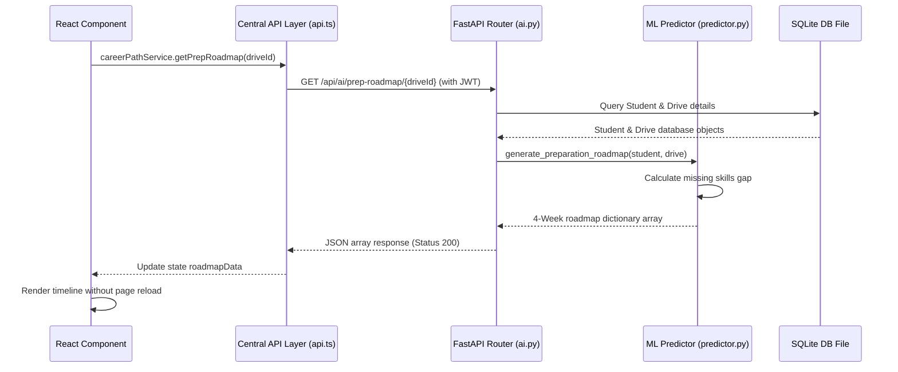

# Project Structure Technical Report
## AI-Powered Placement Intelligence & Student Career Analytics Platform (AP-CPIP)

---

## 1. Executive Summary & Architecture Overview

The **AP-CPIP** platform is structured as a decoupled modern web application with a **Python FastAPI** REST API backend and a **Vite + React (TypeScript)** Single Page Application (SPA) frontend.



---

## 2. Directory Structure Map

```
D:/PLACEMENT PORTAL/
├── backend/
│   ├── app/
│   │   ├── ml/
│   │   │   ├── __init__.py
│   │   │   ├── nlp_feedback.py     # Rules-based NLP sentiment miner & tagger
│   │   │   ├── predictor.py        # Random Forest model trainer & student readiness evaluator
│   │   │   └── resume_scanner.py   # ZIP-XML DOCX text parser & ATS scorer
│   │   ├── routers/
│   │   │   ├── __init__.py
│   │   │   ├── ai.py               # AI student report, ATS scans, roadmaps endpoints
│   │   │   ├── analytics.py        # Lead sheets & aggregate statistics charts endpoints
│   │   │   ├── applications.py      # Placement apply, scheduled interviews, feedbacks endpoints
│   │   │   ├── auth.py             # Login, password hashing & coordinator CRUD endpoints
│   │   │   ├── companies.py        # Corporate profiles directory endpoints
│   │   │   └── students.py         # Student records list, delete, edit metrics endpoints
│   │   ├── __init__.py
│   │   ├── auth.py                 # Cryptography tokens & signature keys validation
│   │   ├── config.py               # Environment configuration settings
│   │   ├── database.py             # SQLAlchemy DB engine session definitions
│   │   ├── main.py                 # FastAPI app definition & middleware configs
│   │   ├── models.py               # SQLAlchemy database schema models
│   │   ├── schemas.py              # Pydantic schemas validation rules
│   │   └── seed.py                 # DB seeding scripts (seeded with 3,000+ candidates)
│   ├── run.py                      # Backend server driver (binds port 8000)
│   └── requirements.txt            # Python dependencies (sklearn, fastapi, sqlalchemy)
└── frontend/
    ├── src/
    │   ├── assets/                 # SVGs and logo vector graphics
    │   ├── components/
    │   │   ├── AccessibilityComponents.tsx # Accessible Toast alerts & modals
    │   │   ├── DashboardLayout.tsx         # Responsive sidebar with active status links
    │   │   ├── LoadingSkeleton.tsx         # Skeleton placeholders
    │   │   └── ProfessionalTable.tsx       # Accessible tabular list with CSV downloaders
    │   ├── hooks/
    │   │   └── useAuth.tsx                 # React Context session auth provider hooks
    │   ├── pages/
    │   │   ├── AISentimentMiner.tsx        # Faculty reviews polarity analytics
    │   │   ├── AdminDashboard.tsx          # System metrics highlights
    │   │   ├── AdminDrives.tsx             # Placement drives management page
    │   │   ├── AdminFaculty.tsx            # CRUD department coordinators
    │   │   ├── AdminLogs.tsx               # Database backups and logs tracker
    │   │   ├── AdminStudents.tsx           # Student Database CRUD portal page
    │   │   ├── FacultyDashboard.tsx        # Officer analytics dashboards
    │   │   ├── LandingPage.tsx             # Public gateway landing page
    │   │   ├── Login.tsx                   # Credentials form layout
    │   │   ├── NotFound.tsx                # 404 handler view
    │   │   ├── PlacementDrives.tsx         # Faculty drives scheduler
    │   │   ├── ReportExporter.tsx          # Institutional PDF & Excel exporters
    │   │   ├── StudentAiReport.tsx         # AI Career Path roadmap page
    │   │   ├── StudentApplications.tsx      # Student active applies tracker
    │   │   ├── StudentDashboard.tsx        # Student placement score dashboards
    │   │   ├── StudentProfile.tsx          # Academic parameter edits & ATS uploads
    │   │   └── StudentTracker.tsx          # Faculty student directory page
    │   ├── services/
    │   │   └── api.ts                      # Centralized Axios API request mapping
    │   ├── App.css
    │   ├── App.tsx                         # React Router routes mapping
    │   ├── index.css                       # Vanilla HSL core styles tokens
    │   └── main.tsx                        # Client root mount file
    ├── index.html
    ├── package.json                        # Node dependencies (vite, react, tailwind)
    ├── tailwind.config.js                  # Tailwind utility configurations
    ├── tsconfig.json                       # TypeScript compiler settings
    └── vite.config.ts                      # Vite build parameters
```

---

## 3. Directory Descriptions & File Interactions

### 3.1 Backend Application Layer (`/backend`)
1. **`app/main.py`**: Declares the `FastAPI` instance. It configures CORS middleware rules to accept headers from client origins (`http://localhost:5173`) and mounts all routers (`auth_router`, `student_router`, `drive_router`, `application_router`, `ai_router`, `analytics_router`) onto the API endpoint prefix tree.
2. **`app/models.py`**: Defines the SQLAlchemy database classes (`User`, `Student`, `Faculty`, `PlacementDrive`, `Feedback`, etc.). These models define table columns, data constraints, and relational mappings used for CRUD queries.
3. **`app/schemas.py`**: Implements Pydantic verification layers that validate inbound JSON bodies before processing router handlers.
4. **`app/routers/`**: Handles specific resource requests:
   * **`students.py`**: Retrieves and filters candidate arrays based on branch departments and backlogs.
   * **`ai.py`**: Connects AI queries to the Scikit-Learn evaluation loops and compiles study roadmaps.
5. **`app/ml/` (Machine Learning Engine)**:
   * **`predictor.py`**: Dynamically retrains the Scikit-Learn **Random Forest Classifier** model when new student records are modified.
   * **`nlp_feedback.py`**: Performs rule-based NLP lexical matching on interview descriptions to extract keywords and sentiment scores.
   * **`resume_scanner.py`**: Extracts text from `.docx` files by parsing zip XML contents to compute ATS matching scores.

---

### 3.2 Frontend Application Layer (`/frontend`)
1. **`src/main.tsx` & `src/App.tsx`**: Sets up the React DOM root tree. `App.tsx` declares routes for `/student`, `/student/profile`, `/student/ai-career-path`, `/admin/students`, etc., wrapped in authentication route guards.
2. **`src/components/`**: House reusable layout modules:
   * **`DashboardLayout.tsx`**: Sidebar navigation template. Evaluates `user.role` to render appropriate workspace links and manages mobile responsive layout changes.
   * **`ProfessionalTable.tsx`**: High-performance grid list component supporting automated search, pagination, and CSV data exports.
3. **`src/pages/`**: Contains page components. Files are mapped directly to React Router endpoints.
4. **`src/services/api.ts`**: Imports an Axios instance configured with a JWT request interceptor that adds the `Authorization: Bearer <token>` header dynamically to all requests.

---

## 4. Operational Flow & Data Communication



This modular structure ensures that the UI, API routing, and AI models remain completely decoupled, allowing for easier maintenance and future scale updates.
